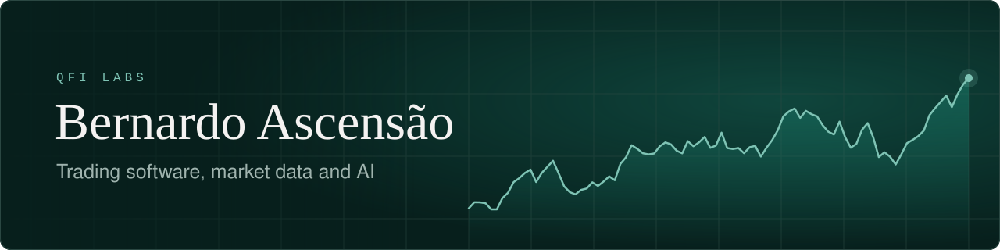

Founder of **[QFI Labs](https://qfi-labs.com)**. I build trading software, market data pipelines and AI tools, from the data layer to the interface. Based in Portugal.

### Building now

<table>
<tr>
<td width="33%" valign="top">
<b><a href="https://qfiterminal.com">QFI Terminal</a></b> 
Financial terminal for stocks, options, macro and crypto.  
<code>live</code>
</td>
<td width="33%" valign="top">
<b><a href="https://deepalphacharts.com">DeepAlpha</a></b> 
Order flow and footprint charts for index futures, on Windows.  
<code>private testing</code>
</td>
<td width="33%" valign="top">
<b><a href="https://qfi-labs.com">QFI Labs</a></b> 
Market research, language models and trading algorithms.  
<code>research</code>
</td>
</tr>
</table>

### Open source

| Project | What it does | |
| --- | --- | --- |
| [Intraday Momentum Strategy](https://github.com/Ascensao/Intraday-momentum-strategy) | Replicates the paper "Beat the Market" on SPY, compares Polygon and Alpaca data and backtests the results | Python&nbsp;·&nbsp;★&nbsp;8 |
| [ChatGPT Voice Assistant](https://github.com/Ascensao/python_chatGPT_voice) | Voice assistant built on the ChatGPT API | Python&nbsp;·&nbsp;★&nbsp;12 |
| [Crypto Performance Tracker](https://github.com/Ascensao/crypto-performance-tracker) | Downloads crypto market data and charts comparative performance | Python |
| [InstaReel Bulk Download](https://github.com/Ascensao/InstaReelBulkDownload) | Bulk download of Instagram Reels | Python |
| [Plate Vision](https://github.com/Ascensao/plate-vision) | Licence plate detection with a deep-learning model | Python |
| [Website Image Optimizer](https://github.com/Ascensao/WebsiteImageOptimizer) | Bulk WebP conversion for faster websites | Python |

### Stack

### Contact

[qfiterminal.com](https://qfiterminal.com) · [qfi-labs.com](https://qfi-labs.com) · [Instagram](https://www.instagram.com/qfiterminal/) · [X](https://x.com/qfi_terminal) · [YouTube](https://www.youtube.com/@aiavenue1) 
Projects and partnerships: info@qfi-labs.com

<picture>
  <source media="(prefers-color-scheme: dark)" srcset="https://raw.githubusercontent.com/Ascensao/ascensao/output/github-contribution-grid-snake-dark.svg">
  
</picture>
